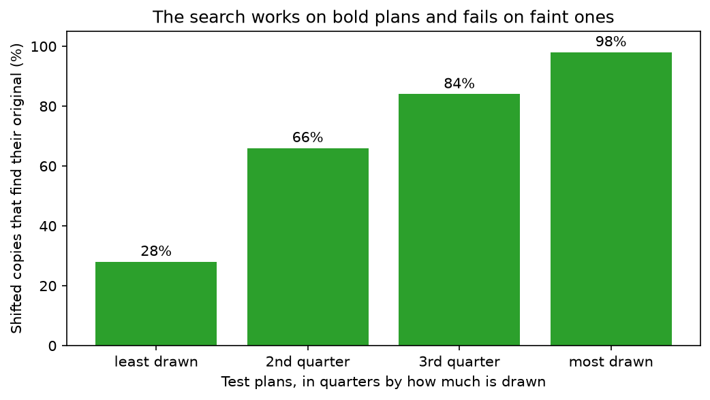
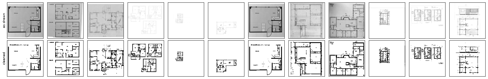
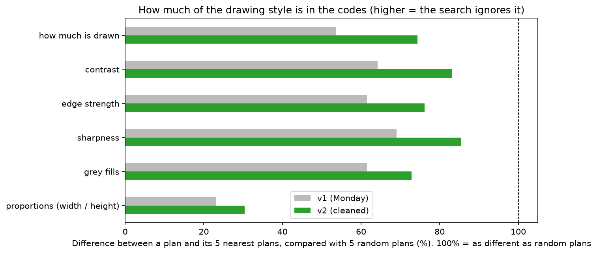
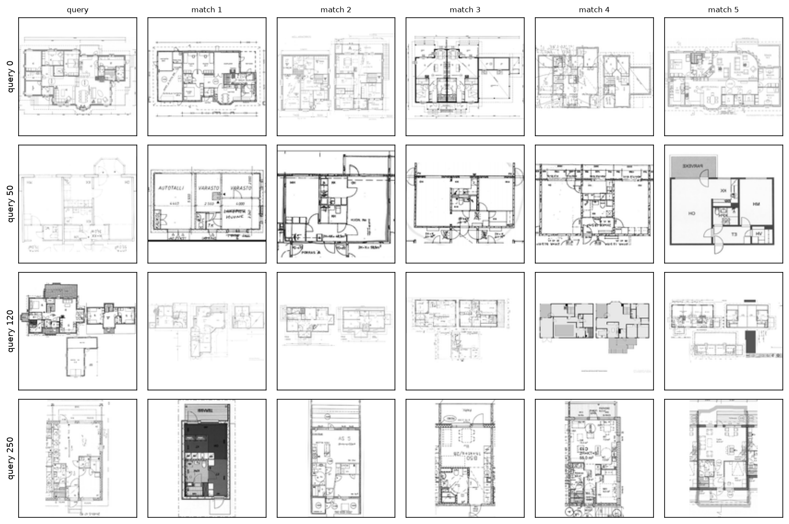
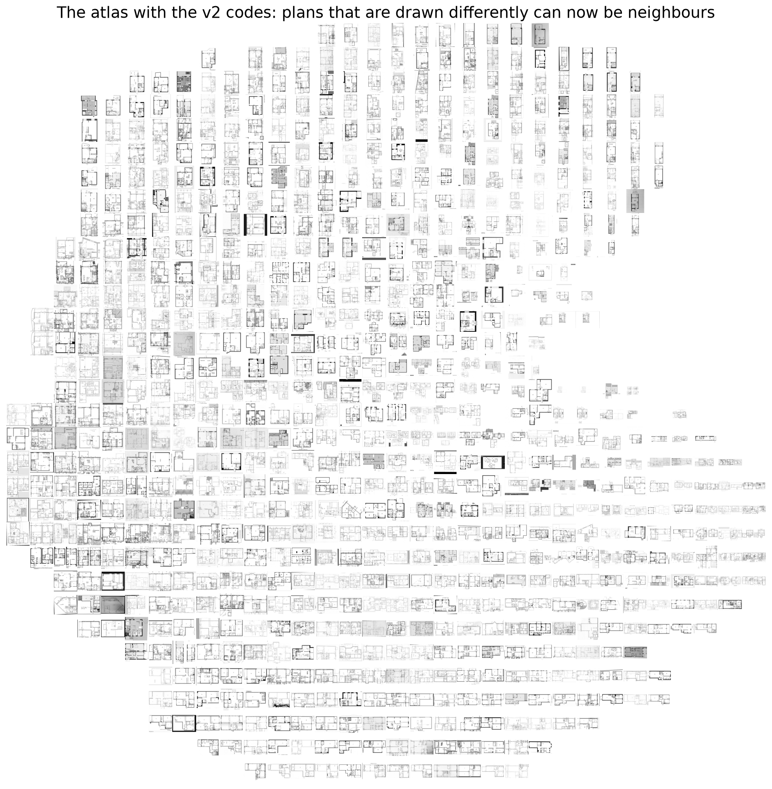
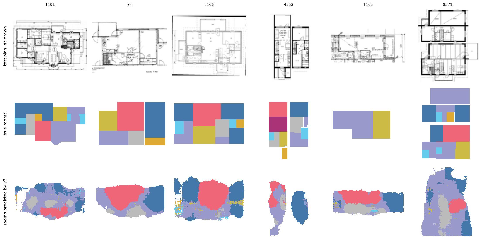
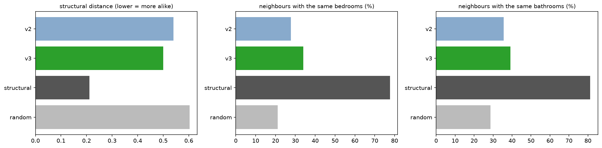

# 01: the autoencoder (Monday)

Team 6, floor-plan similarity search

**Model on Hugging Face:** https://huggingface.co/iaac-maai/hackathon-team6-cubicasa-ae

## Use case

An architect uploads a floor plan and gets back the five most similar plans out of 5,000 real homes, as precedents for a new project. A convolutional autoencoder squeezes every plan into a code of 128 numbers. Similar layouts get codes close to each other, so the search is just finding the nearest codes. Out of the five uses in the class notebook, this is similarity search.

## Dataset

| | |
|---|---|
| Name | CubiCasa5K |
| Source | [Zenodo 2613548](https://zenodo.org/records/2613548) |
| Size | 5,000 floor-plan images, official split 4,200 / 400 / 400, one 5.5 GB zip |
| Licence | CC BY-NC-SA 4.0 |
| Cite | Kalervo, A. et al. (2019), CubiCasa5K: A Dataset and an Improved Multi-Task Model for Floorplan Image Analysis, SCIA |
| Preprocessing | the first floor of each home, `F1_scaled.png`; greyscale, inverted so the walls are bright, padded to a square, 128 x 128 px, pixels between 0 and 1 |

## How to run

```bash
cd 01_autoencoder
python -m venv .venv
source .venv/bin/activate        # Windows: .venv\Scripts\activate
pip install -r requirements.txt
```

1. Put the data in `01_autoencoder/data/`: either the 5.5 GB `cubicasa5k.zip` from Zenodo, or `cubicasa5k_128.npz` (27 MB), which the notebook builds from the zip the first time.
2. Open `notebook/autoencoder.ipynb` and run all. On a laptop CPU the three setups train in about 7 minutes, and version 2 in about 3 more.

The notebook saves the figures in `figures/`, what the server needs in `model_app/` and everything for Hugging Face in `models/`.

## Setups compared

Same official split, same seed (42), 20 epochs, batches of 64, Adam with learning rate 0.001. Trained with binary cross-entropy and scored with MSE.

| Setup | Parameters | Training time | Validation MSE | Test MSE | Retrieval top-1 (test) |
|---|---|---|---|---|---|
| A: dense, code 64 | 8,438,336 | about 30 s | 0.0153 | 0.0162 | 21% |
| B: conv, code 32 | 386,657 | about 3 min | 0.0146 | 0.0153 | 47% |
| C: conv, code 128 | 1,173,185 | about 3.5 min | 0.0123 | 0.0131 | 69% |

Retrieval top-1: every test plan is shifted by 3 pixels and gets a bit of noise, and we count how often its closest code among the 400 test plans is the original.

For scale: a blank page gets a test MSE of 0.0300 and the average training plan 0.0243, so C (0.0131) is 46% below the average plan. The numbers only look small because the lines are 6.5% of the pixels.

We keep C. Convolutions beat the dense model at 128 px (B has 22 times fewer parameters than A and still rebuilds better), and a code of 128 numbers tells plans apart much better than 32.


Is the autoencoder worth it? On the same test the raw pixels find the original only 4% of the time, because a shift of 3 pixels moves every line onto other pixels, and PCA with 128 numbers 25%. The autoencoder gets 69% with the same 128 numbers.

## Results


Four test plans (left) and their five closest plans out of the 5,000. The matches have the same footprint and proportions: the narrow plan finds narrow plans, the plan made of three buildings finds plans with two or three volumes. Some matches are wrong for us, though: three matches of the first query are pale scans, and the first match of the second query is a small square plan full of text.


All 5,000 plans placed on a map by their codes (UMAP), drawn as themselves. Narrow plans are on the left and wide ones on the right, bold drawings at the top and small, very wide plans at the bottom. The model found this order by itself, only by learning to redraw the plans.



The search works on bold plans and fails on faint ones: 98% of the copies find their original on the quarter of plans with the most lines, only 28% on the quarter with the fewest.


Input plans and how A, B and C rebuild them. A gives a grid-like blur, B keeps only the outline, and C keeps the outline and the main inner walls.


All three setups were still improving at epoch 20.

## Version 2: compare the layout, not the drawing style

Version 1 grouped plans by how they're drawn (bold, faint, grey fills) as much as by their layout: a faint scan mostly found faint scans. Section 6 of the notebook fixes this, with ideas from Chloe's notebook:
- **measure the style:** her rendering features (how much is drawn, contrast, edge strength, sharpness), to see how much of them is in the codes, and her error on the drawn pixels only;
- **take the style out:** every plan is cleaned down to its lines before the model. A 5 x 5 px opening finds the wide parts (grey fills, grey paper, dark borders), the plan minus these parts leaves the lines, and each plan's lines are scaled by its own strong lines and cut into black and white;
- **train setup C again** on the cleaned plans, with the same settings.



| | v1 | v2 |
|---|---|---|
| Retrieval top-1 (test) | 69% | **86%** |
| Faintest quarter of the plans | 28% | **77%** |
| Boldest quarter of the plans | 98% | 81% |



For each feature we compare a plan with its 5 nearest plans and with 5 random plans: 100% means the search ignores it. With v2 every style feature moves towards 100% (how much is drawn from 54% to 74%, sharpness from 69% to 85%), while the proportions stay low (23% to 30%): the neighbours still have the same shape, whatever pen drew them. The boldest plans lose, because walls thicker than about 5 px partly disappear in the cleaning.



The same four queries with v2. The faint scan (second row) now finds bold drawings with the same layout, and the narrow flat (last row) finds narrow flats with the balcony and the bathroom in the same places.



On the v2 atlas bold, grey and faint drawings are mixed, and the map is ordered by shape: tall, narrow plans at the top, wide ones at the bottom, small drawings on the right. 
## Model

The model is on [Hugging Face](https://huggingface.co/iaac-maai/hackathon-team6-cubicasa-ae), versions 1, 2 and 3. Version 3 is exported by `notebook/internal_layout_v3.ipynb`, with its codes, its atlas positions and the room maps of the 5,000 plans. In `model_app/` the configs, `collection_ids.json` and the example plans are on GitHub, while the models (`floorplan_ae.onnx` and `floorplan_ae_v2.onnx`, two outputs each: the code and the reconstruction), the codes of all 5,000 plans (`collection_codes.npy`, `collection_codes_v2.npy`) and the v2 atlas positions (`atlas_v2_xy.npy`) are only on Hugging Face.

## Limitations

- At 128 px thin walls, doors, furniture and text blur, so the model compares the overall shape, not the details.
- Similar pixels aren't a similar use: two plans can look alike and have very different room programmes. We don't use the room annotations.
- The way a plan is drawn still counts. In v1 faint scans were found much less often (28% against 98% for the boldest plans) and they mostly found other faint scans. v2 brings the faint plans to 77%, but the boldest drop to 81%, and line thickness and the size of the drawing on the page still count.
- Retrieval is 86% with v2 (69% with v1), not 100%: in about 1 out of 7 cases a slightly shifted copy doesn't find its own original first.
- Mostly Finnish homes, and not rotation-invariant: a plan turned by 90 degrees may not find its original.
- CC BY-NC-SA 4.0, so non-commercial use only.

## Slides

The three slides: [`slides/team6_monday.pdf`](slides/team6_monday.pdf).

## Version 3: compare the rooms, not only the lines (Chloe's notebook)

Version 2 compares the cleaned lines. Two plans can have the same outline and very different rooms, so Chloe's notebook [`notebook/internal_layout_v3.ipynb`](notebook/internal_layout_v3.ipynb) goes to the room programme. It reads the annotations of CubiCasa5K (`model.svg`: every room with its type, the walls, the doors), draws them as room maps with 10 room types, and searches by room counts, room areas and where each type sits in the plan. That search needs the annotations, which an uploaded plan doesn't have.

So section 8 of the same notebook trains **v3**: the encoder of setup C reads the cleaned drawing, and the decoder has to draw the room map and the walls. The code in the middle has to hold the layout, and it works on any uploaded drawing.



It finds the plan area (68% overlap) and puts the living room and the bedrooms roughly in the right places. It hardly finds bathrooms and kitchens: at 128 px, after the cleaning, their fixtures and names are mostly gone.



For the 373 test plans with annotations we judged the 5 nearest training plans with the annotations:

| | v2 | v3 | Chloe's structural search | random |
|---|---|---|---|---|
| Same number of bedrooms | 28% | **34%** | 78% | 21% |
| Same number of bathrooms | 36% | **39%** | 81% | 29% |
| Rooms off by | 4.7 | **3.7** | 1.4 | 5.7 |

v3 beats v2 on every measure, by a little. The structural search uses the true annotations, so it's the best case and not something the app can do with an upload: it shows how much is left to gain. The model server uses v3.


All 5,000 plans placed by their v3 codes and drawn as their rooms: compact plans with a big living room and two or three bedrooms at the top right, wide houses on the left, small sheets with several homes at the bottom.

Only the 5,000 `model.svg` files (44 MB) are needed, in `data/cubicasa5k/`; the drawings come from `data/cubicasa5k_128.npz`. The notebook also has Chloe's synthetic checks and a review sheet to judge matches by hand (sections 9 to 11). The review sheet hasn't been filled in yet.
