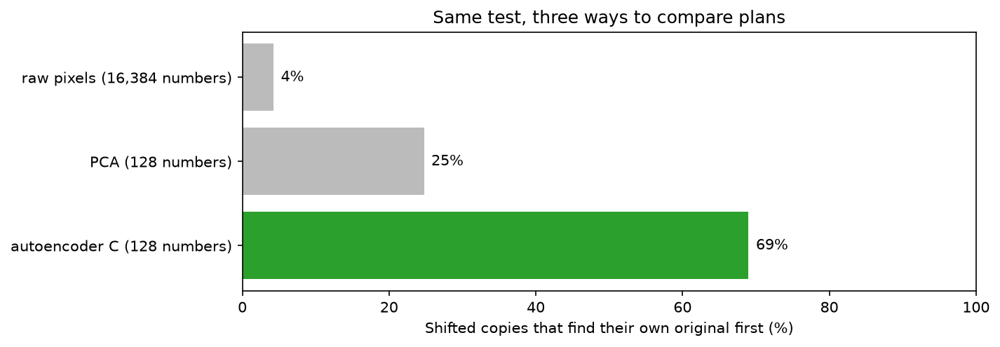
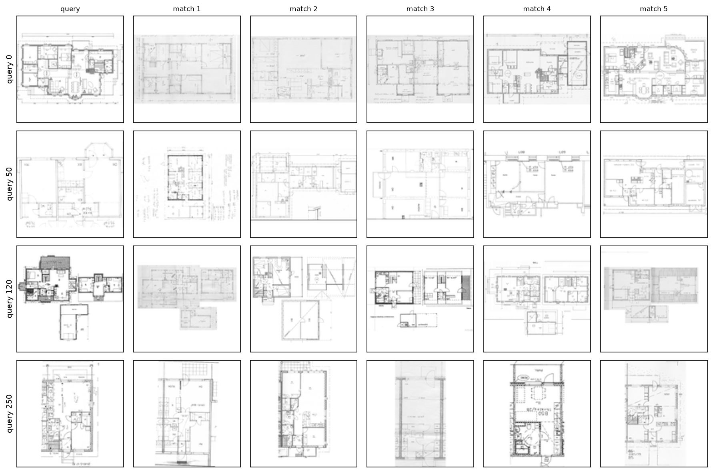
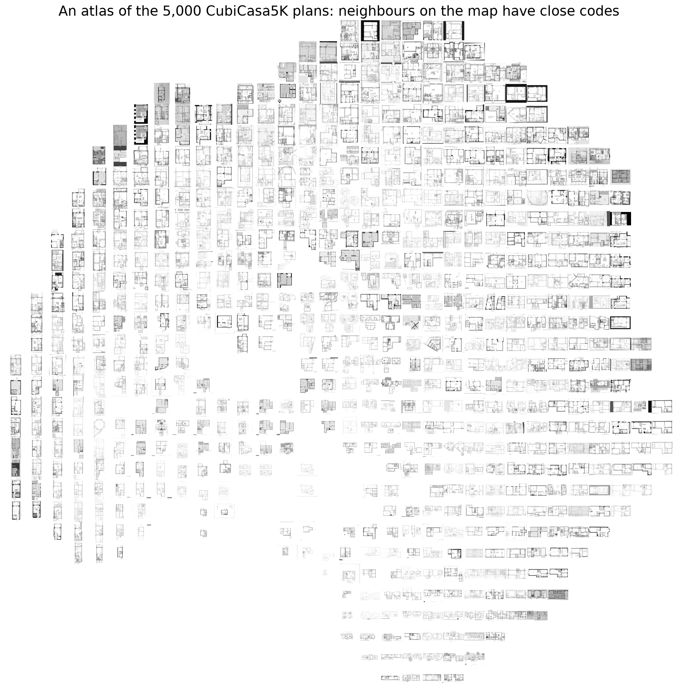
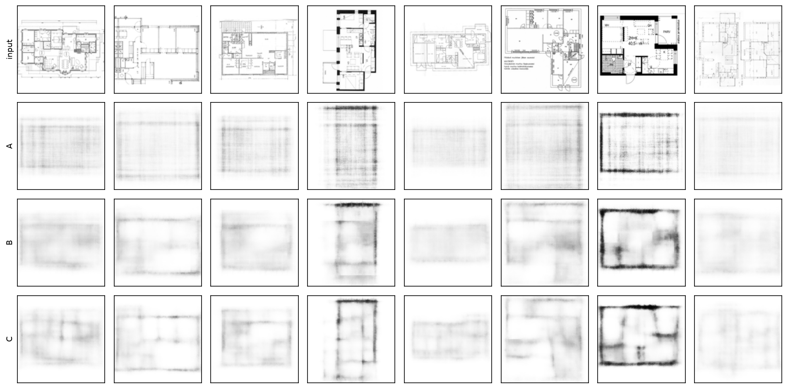
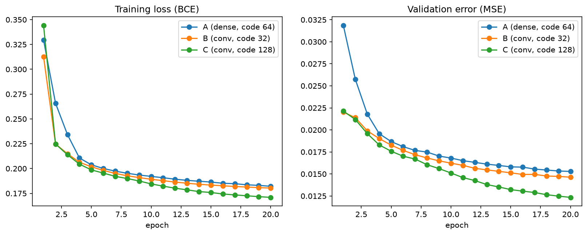

# 01: the autoencoder (Monday)

Team 6, floor-plan similarity search

**Model on Hugging Face:** https://huggingface.co/iaac-maai/hackathon-team6-cubicasa-ae

## Use case

An architect uploads a floor plan and gets back the five most similar plans out of 5,000 real homes, as precedents for a new project. A convolutional autoencoder squeezes every plan into a code of 128 numbers. Similar layouts get codes close to each other, so the search is just finding the nearest codes. Out of the five uses in the class notebook, this is similarity search.

## Dataset

| | |
|---|---|
| Name | CubiCasa5K |
| Source | [Zenodo 2613548](https://zenodo.org/records/2613548) |
| Size | 5,000 floor-plan images (official split: 4,200 train, 400 validation, 400 test), one 5.5 GB zip |
| Licence | CC BY-NC-SA 4.0 |
| Cite | Kalervo, A. et al. (2019), CubiCasa5K: A Dataset and an Improved Multi-Task Model for Floorplan Image Analysis, SCIA |
| Preprocessing | the first floor of each home (`F1_scaled.png`), greyscale, inverted (walls bright), padded to a square, 128 x 128 px, pixels between 0 and 1 |

## How to run

```bash
cd 01_autoencoder
python -m venv .venv
source .venv/bin/activate        # Windows: .venv\Scripts\activate
pip install -r requirements.txt
```

1. Put the data in `01_autoencoder/data/`: either the 5.5 GB `cubicasa5k.zip` from Zenodo, or `cubicasa5k_128.npz` (27 MB), which the notebook builds from the zip the first time.
2. Open `notebook/autoencoder.ipynb` and run all. On a laptop CPU the three setups train in about 7 minutes.

The notebook saves the figures in `figures/`, what the server needs in `model_app/` and everything for Hugging Face in `models/`.

`notebook/cubicasa_autoencoder_first_try.ipynb` is our first try, kept with its outputs. It trained with MSE: the codes of 8 and 32 collapsed to a blank page and the code of 16 reached a test MSE of 0.0185. That's why the main notebook trains with BCE. It doesn't need to be run.

## Setups compared

Same official split, same seed (42), 20 epochs, batches of 64, Adam with learning rate 0.001. Trained with binary cross-entropy and scored with MSE.

| Setup | Parameters | Training time | Validation MSE | Test MSE | Retrieval top-1 (test) |
|---|---|---|---|---|---|
| A: dense, code 64 | 8,438,336 | about 30 s | 0.0153 | 0.0162 | 21% |
| B: conv, code 32 | 386,657 | about 3 min | 0.0146 | 0.0153 | 47% |
| C: conv, code 128 | 1,173,185 | about 3.5 min | 0.0123 | 0.0131 | 69% |

Retrieval top-1: every test plan is shifted by 3 pixels and gets a bit of noise, and we count how often its closest code among the 400 test plans is the original.

For scale: a blank page gets a test MSE of 0.0300 and the average training plan 0.0243, so C (0.0131) is 46% below the average plan. The numbers only look small because the lines are 6.5% of the pixels.

We keep C. Convolutions beat the dense model at 128 px (B has 22 times fewer parameters than A and still rebuilds better), and a code of 128 numbers tells plans apart much better than 32.



Is the autoencoder worth it? On the same test the raw pixels find the original only 4% of the time, because a shift of 3 pixels moves every line onto other pixels, and PCA with 128 numbers 25%. The autoencoder gets 69% with the same 128 numbers.

## Results



Four test plans (left) and their five closest plans out of the 5,000. The matches have the same footprint and proportions: the narrow plan finds narrow plans, the plan made of three buildings finds plans with two or three volumes. Some matches are wrong for us, though: three matches of the first query are pale scans, and the first match of the second query is a small square plan full of text.



All 5,000 plans placed on a map by their codes (UMAP), drawn as themselves. Narrow plans are on the left and wide ones on the right, bold drawings at the top and small, very wide plans at the bottom. The model found this order by itself, only by learning to redraw the plans.


The search works on bold plans and fails on faint ones: 98% of the copies find their original on the quarter of plans with the most lines, only 28% on the quarter with the fewest.



Input plans and how A, B and C rebuild them. A gives a grid-like blur, B keeps only the outline, and C keeps the outline and the main inner walls.



All three setups were still improving at epoch 20.

## Model

The model is on [Hugging Face](https://huggingface.co/iaac-maai/hackathon-team6-cubicasa-ae). In `model_app/` the config, `collection_ids.json` and the example plans are on GitHub, while `floorplan_ae.onnx` (two outputs: the code and the reconstruction) and `collection_codes.npy` (the codes of all 5,000 plans) are only on Hugging Face.

## Limitations

- At 128 px thin walls, doors, furniture and text blur, so the model compares the overall shape, not the details.
- Similar pixels aren't a similar use: two plans can look alike and have very different room programmes. We don't use the room annotations.
- The way a plan is drawn still counts: faint scans are found much less often (28% against 98% for the boldest plans), and they often find other faint scans.
- Retrieval is 69%, not 100%: in about 3 out of 10 cases a slightly shifted copy doesn't find its own original first.
- Mostly Finnish homes, and not rotation-invariant: a plan turned by 90 degrees may not find its original.
- CC BY-NC-SA 4.0, so non-commercial use only.

## Slides

The three slides: [`slides/team6_monday.pdf`](slides/team6_monday.pdf).
