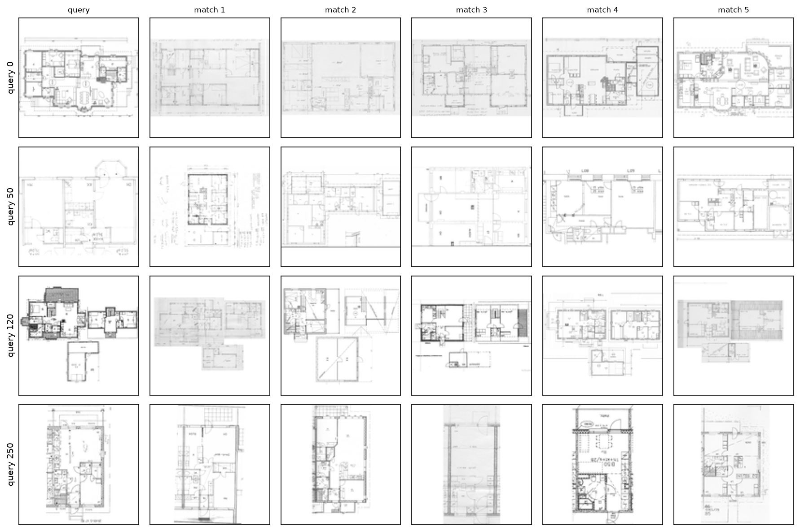
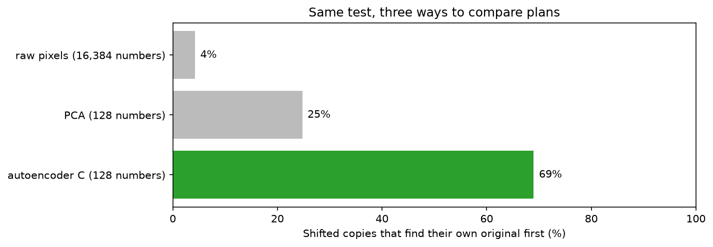
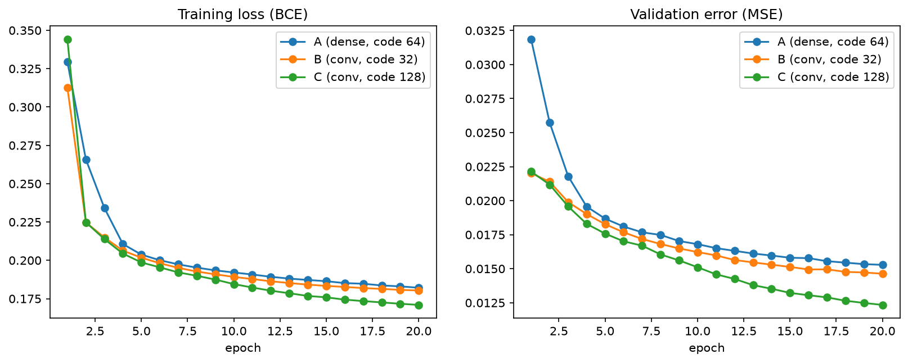
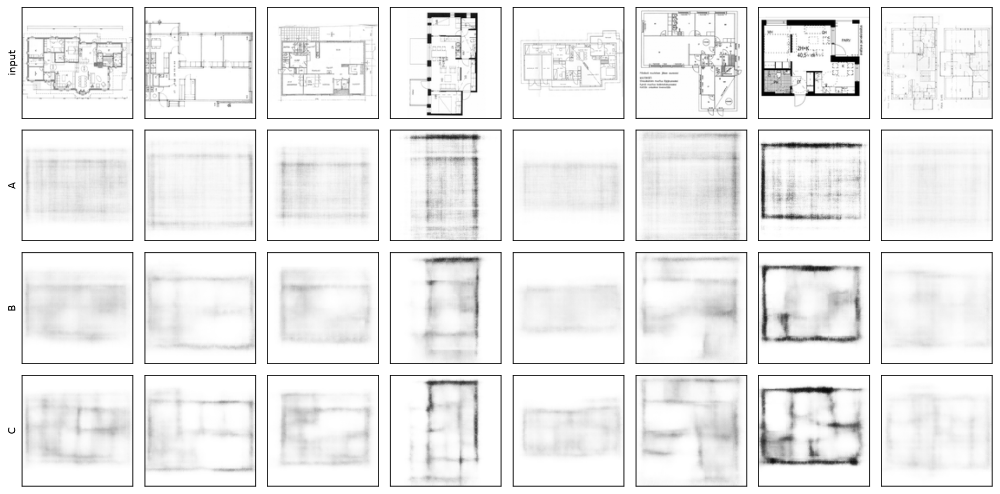
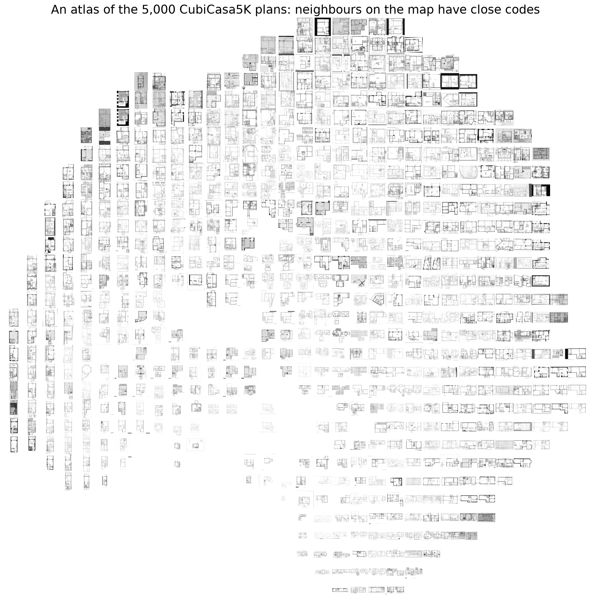
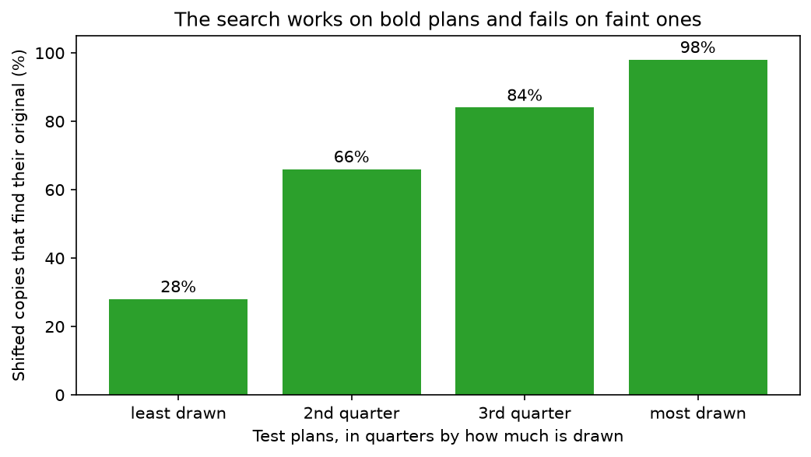

# Floor-plan autoencoder for similarity search (Team 6)

A convolutional autoencoder that squeezes a floor-plan image (128 x 128 px) into a code of 128 numbers, so that plans with a similar layout get codes close to each other. We use it for precedent search: an architect uploads a plan and gets the five most similar plans out of 5,000 real homes. It was made in the AI Methods I hackathon (IAAC MaAI 2026/27).

- **GitHub repository:** https://github.com/iaac-maai/hackathon-team6-cubicasa
- **Team:** Chloe Hraibeh, Jeff El Khoury, Luca Obejdeanu



Four test plans (left) and their five closest plans out of the 5,000. The matches have the same footprint and proportions: the narrow plan finds narrow plans, the plan made of three buildings finds plans with two or three volumes. The mistakes are in the figure too: three matches of the first query are pale scans, and the first match of the second query is a small square plan full of text.

## What's in this repository

| File | What it is |
|---|---|
| `floorplan_ae.onnx` | the model, 4.5 MB. Two outputs: `code` (N x 128, used for the search) and `reconstruction` (N x 1 x 128 x 128, the plan rebuilt from the code) |
| `floorplan_ae.pt` | the same weights for PyTorch |
| `floorplan_ae_config.json` | the image size, the preprocessing steps and the code size |
| `collection_codes.npy` | the codes of all 5,000 CubiCasa5K plans |
| `collection_ids.json` | the plan each code belongs to |
| `examples/` | four test plans to try |

## Dataset

| | |
|---|---|
| Name | [CubiCasa5K](https://zenodo.org/records/2613548) |
| Size | 5,000 floor-plan images, mostly of Finnish homes; official split 4,200 / 400 / 400 |
| Licence | CC BY-NC-SA 4.0. This model is trained on it, so it keeps the same licence: non-commercial use only |
| Cite | Kalervo, A. et al. (2019), CubiCasa5K: A Dataset and an Improved Multi-Task Model for Floorplan Image Analysis, SCIA |

## Architecture and preprocessing

- **Encoder:** 4 convolutions with stride 2 (1, 16, 32, 64 and 64 channels; 128, 64, 32, 16 and 8 px) with ReLU, then a linear layer down to the 128 numbers of the code.
- **Decoder:** the same in reverse, with transposed convolutions and a sigmoid at the end.
- **Parameters:** 1,173,185.
- **Preprocessing**, which must be exactly the same when you use it: greyscale, invert (walls bright, background dark), pad to a square with black, resize to 128 x 128 (Lanczos), pixels between 0 and 1. Input shape N x 1 x 128 x 128, `float32`.

## Training and the setups we compared

Official split, seed 42, 20 epochs, batches of 64, Adam with learning rate 0.001, on a laptop CPU. We trained with binary cross-entropy, because with MSE the models got stuck drawing a blank page (only 6.5% of the pixels are lines), and we score with MSE. For scale: a blank page gets a test MSE of 0.0300 and the average training plan 0.0243.

| Setup | Parameters | Test MSE | Retrieval top-1 (test) |
|---|---|---|---|
| A: dense, code 64 | 8,438,336 | 0.0162 | 21% |
| B: conv, code 32 | 386,657 | 0.0153 | 47% |
| **C: conv, code 128 (this model)** | 1,173,185 | **0.0131** | **69%** |

Retrieval top-1: every test plan is shifted by 3 pixels and gets a bit of noise, and we count how often its closest code among the 400 test plans is the original.



The same test with two simpler ways of comparing plans. The raw pixels find the original only 4% of the time, because a shift of 3 pixels moves every line onto other pixels, and PCA with 128 numbers 25%. With the same 128 numbers the autoencoder gets 69%, so the neural network is worth it here.



The training loss (BCE) and the validation error (MSE) of the three setups. All of them were still improving at epoch 20, and C ends with the lowest validation error.



Input plans and how A, B and C rebuild them. A gives a grid-like blur, B keeps only the outline, and C keeps the outline and the main inner walls. None of them keeps doors, furniture or text.

## What the codes learned



All 5,000 plans placed on a map by their codes (UMAP), drawn as themselves: every cell of the grid shows the plan closest to its centre. Narrow plans are on the left and wide ones on the right, bold drawings at the top and small, very wide plans at the bottom. The model found this order by itself, only by learning to redraw the plans. It groups plans by shape and by how they're drawn, not by how the rooms are used.

## Limitations: where it fails



The test plans in four quarters by how much is drawn on them. On the boldest quarter 98% of the shifted copies find their original, on the faintest only 28%: a faint scan gives the encoder little to hold on to.

- At 128 px thin walls, doors and text blur, so it compares the overall shape and how much is drawn, not the room programme.
- The way a plan is drawn influences the matches: faint scans are found much less often, and they often find other faint scans.
- Retrieval is 69%: in about 3 out of 10 cases a slightly shifted copy doesn't find its own original first.
- It isn't rotation-invariant, and it was trained on mostly Finnish homes.
- Non-commercial licence, inherited from the data.

## How to use

```python
import json
import numpy as np
import onnxruntime as ort
from PIL import Image, ImageOps
from huggingface_hub import hf_hub_download

repo = "iaac-maai/hackathon-team6-cubicasa-ae"
session = ort.InferenceSession(hf_hub_download(repo, "floorplan_ae.onnx"))
collection = np.load(hf_hub_download(repo, "collection_codes.npy"))
ids = json.load(open(hf_hub_download(repo, "collection_ids.json")))


def preprocess(path, size=128):
    #the same steps as in training: greyscale, invert, pad to a square, 128 px, 0-1
    plan = ImageOps.invert(ImageOps.grayscale(Image.open(path)))
    side = max(plan.size)
    square = Image.new("L", (side, side), 0)
    square.paste(plan, ((side - plan.width) // 2, (side - plan.height) // 2))
    small = square.resize((size, size), Image.Resampling.LANCZOS)
    return (np.asarray(small, dtype=np.float32) / 255)[None, None]   # shape (1, 1, 128, 128)


plan_path = hf_hub_download(repo, "examples/plan_high_quality_architectural_1191.png")
code, reconstruction = session.run(None, {"image": preprocess(plan_path)})
distances = np.linalg.norm(collection - code, axis=1)
for i in np.argsort(distances)[:5]:
    print(ids[i], round(float(distances[i]), 1))
```

The first result is the plan itself, because it's in the collection too.

## Links

- Code and notebook: https://github.com/iaac-maai/hackathon-team6-cubicasa
- Authors: Chloe Hraibeh, Jeff El Khoury, Luca Obejdeanu, AI Methods I, IAAC MaAI 2026/27
