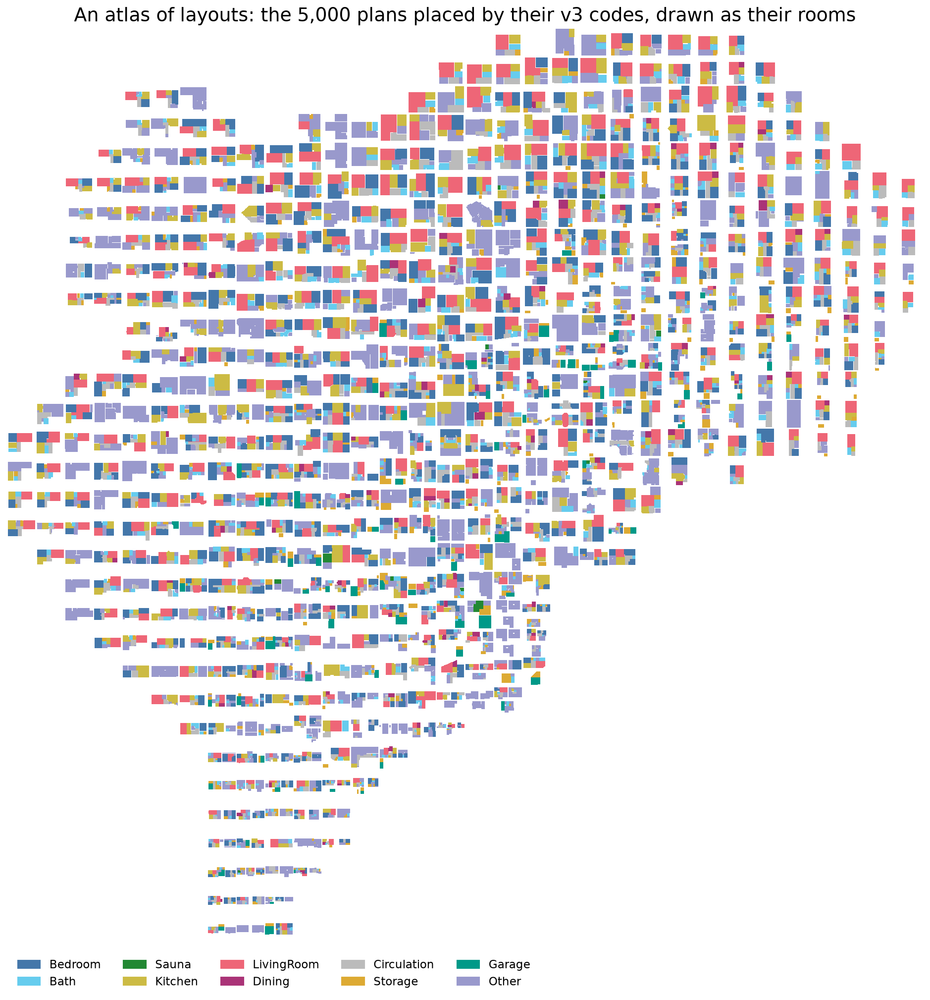

# Team 6: floor-plan similarity search

Chloe Hraibeh, Jeff El Khoury, Luca Obejdeanu
AI Methods I, hackathon, IAAC MaAI 2026/27 (16 to 20 November 2026)

**Model on Hugging Face:** https://huggingface.co/iaac-maai/hackathon-team6-cubicasa-ae

## The idea

An architect starting a housing project looks for precedents: plans that look like the one on their desk. Our app lets them upload a floor plan and gives back the five most similar plans out of 5,000 real homes (CubiCasa5K).

Behind it there's a convolutional autoencoder that squeezes every plan into a code of 128 numbers. Plans with a similar layout get codes that are close to each other, so finding similar plans means finding the closest codes.

All 5,000 plans placed on a map by their codes and drawn as their rooms. Our first model compared how plans are drawn, the second the cleaned lines. The third, built on Chloe's notebook, learned to draw the rooms from the lines, so its neighbours are closer as homes: 34% of them have the same number of bedrooms, against 28% for the second model and 21% for random plans. The details are in [`01_autoencoder/`](01_autoencoder/).

## Live parts

| Part | Link | Day |
|---|---|---|
| Model on Hugging Face | https://huggingface.co/iaac-maai/hackathon-team6-cubicasa-ae | Monday |
| Model server (Render) | https://hackathon-team6-cubicasa.onrender.com | Tuesday |
| App, first version (Cloudflare Pages) | https://hackathon-team6-cubicasa-app.pages.dev | Wednesday |
| App, React on Workers with Look inside | https://hackathon-team6-cubicasa-app.hackathon-team6-cubicasa-app.workers.dev | Wednesday |

## Repository

| Folder | What's in it |
|---|---|
| [`01_autoencoder/`](01_autoencoder/) | Monday: the data preparation, the notebook with three setups, the ONNX model, the model card and the slides. Tuesday: version 2 of the model, trained on cleaned plans (section 6 of the notebook), and version 3, which reads the rooms (`notebook/internal_layout_v3.ipynb`, by Chloe) |
| [`02_model_server/`](02_model_server/) | Tuesday: the model server (Gradio and ONNX Runtime on Render), its API and a notebook that calls it. Wednesday: `/predict_model`, to choose the network, and `/explain_model`, what every layer computes for one plan |
| [`03_app/`](03_app/) | Wednesday: the app on Cloudflare, behind a password. A React page and a Worker that calls the model server, D1 for the searches and R2 for the plans. Look inside shows what the network computed: where the plan lands among the 5,000, how close the five matches are, what each layer sees. Our user stories and diagrams are in `03_app/diagrams/` |

## Dataset

[CubiCasa5K](https://zenodo.org/records/2613548): 5,000 floor-plan images, mostly of Finnish homes. Kalervo et al. (2019), SCIA. The dataset is CC BY-NC 4.0. [CubiCasa5K licence](https://github.com/CubiCasa/CubiCasa5k/blob/master/LICENSE). The data isn't in this repository.

## AI usage

| | |
|---|---|
| Tools | Claude Code (agent) |
| Why | to get going fast on a dataset and a kind of model that were new for us, and for the first drafts of the texts |
| Where | Monday: the comparison of datasets, the data preparation, the notebook code (adapted from the class notebook), the plots, the texts, the model card and the slides. Tuesday: version 2 of the model, the model part of Chloe's notebook for version 3, the server code (adapted from the class example `model_app/`), its README and `call_api.ipynb`. Wednesday: moving Jeff's first version of the app to React on Workers, the Look inside view and the `/explain_model` endpoint behind it, the script for the map data, and the texts of `03_app/README.md` |
| How | we went through several datasets of the course list with it (HVAC faults, weld radiographs, 3D printing, ResPlan) before choosing CubiCasa5K. We asked it to follow the class notebook and to train the three setups on the same split and seed. Then we ran the notebook again on our laptop and checked every number in the texts against the outputs. For the server we checked that each example plan finds itself first, at the same distance as in the notebook, so the server prepares the images the same way. For the app we compared four looks on the running page and chose one, and we checked the figures against the model: the distance of each match against `/predict_model`, the layer sizes and weights against the ONNX file |

Lessons learned: in two separate first tries we trained with MSE, like in class, and most of the models only learned to draw a blank page. Only 6.5% of the pixels are lines, so a blank page is already 95% right and the error looked fine. You have to look at the reconstructions, and compare the error with a dumb baseline like the blank page, not only read the number.

## Licence

MIT for the code, see [LICENSE](LICENSE). CubiCasa5K is CC BY-NC 4.0. [CubiCasa5K licence](https://github.com/CubiCasa/CubiCasa5k/blob/master/LICENSE).

See the [aligned model workflow](01_autoencoder/README.md#aligned-layout-model-v4) for the validation comparison and local export.
